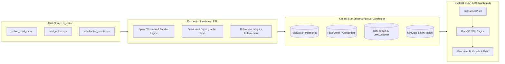

# GlobalShop Enterprise Big Data & Analytics Pipeline

An end-to-end, reproducible Big Data analytics lakehouse pipeline for **GlobalShop Inc.**, a global omnichannel e-commerce enterprise. The pipeline ingests multi-source transactional and behavioral clickstream datasets, executes distributed data cleansing and validation, models the lakehouse into a **Kimball Star Schema** (`FactSales`, `FactFunnel`, and four dimension tables), writes partitioned Parquet tables, executes authentic analytical SQL queries using an in-process **DuckDB OLAP engine**, and powers executive business intelligence dashboards.

---

## Architectural Overview




* **Data Sources**:
  * `online_retail_ii.csv`: Primary e-commerce transactions (invoices, line-items, quantities, unit prices).
  * `olist_orders.csv`: Regional South American orders, payments, and fulfillment status. Cleansed and staged as an independent auxiliary dataset (`orders_clean.parquet`) for logistics profiling, intentionally decoupled from the core retail `FactSales` transaction grain.
  * `retailrocket_events.csv`: Behavioral clickstream events (views, add-to-cart, transactions).
* **Decoupled ETL Processing**:
  * **Modular Architecture**: Clean separation into `etl/config.py`, `etl/schemas.py`, `etl/engines/`, and `etl/main.py`.
  * **Dual Engine Parity**: Distributed Apache Spark (`local[*]` or cluster mode) with automatic fallback to high-performance vectorized Pandas/PyArrow.
  * **Distributed-Safe Surrogate Keys**: Deterministic 64-bit SHA-256 surrogate keys (`ProductKey`, `CustomerKey`, `RegionKey`, `SalesKey`, `FunnelKey`) completely eliminate single-partition `Window.orderBy` cluster bottlenecks and eliminate 32-bit `CRC32` hash collision risks across both Spark and Pandas engines.
  * **Data Quality**: Filters invalid negative quantities (returns), drops zero-unit prices, imputes missing customer identities to `'GUEST'`, and deduplicates line items.
* **Analytical Modeling (Kimball Star Schema)**:
  * `FactSales`: Transaction grain with surrogate keys (`ProductKey`, `CustomerKey`, `DateKey`, `RegionKey`), `InvoiceTimestamp`, and partitioned by `(Year, Month)` (monolithic duplicate exports eliminated for zero redundant I/O).
  * `FactFunnel`: Behavioral clickstream funnel grain (`VisitorID`, `StockCode`, `ProductKey`, `Views`, `AddToCart`, `Transactions`, `Converted`).
  * `DimProduct`: Product catalog with surrogate `ProductKey`, `StockCode`, `Description`, and `UnitPrice`.
  * `DimCustomer`: Customer dimension with surrogate `CustomerKey`, `CustomerID`, `Country`, and foreign key `RegionKey`.
  * `DimDate`: Comprehensive date dimension with integer `DateKey` (`YYYYMMDD`), `Year`, `Month`, `Day`, `DayOfWeek`, and `Quarter`.
  * `DimRegion`: Country dimension with surrogate `RegionKey` joined to `FactSales` and `DimCustomer`.
* **DuckDB In-Memory OLAP Querying**:
  * Direct execution of production `.sql` scripts against the Parquet Lakehouse using DuckDB's `hive_partitioning=true` without intermediate in-memory flattening.
  * Continuous time-series reindexing to guarantee robust Year-over-Year (YoY) metrics.

---

## Repository Structure

```
05_globalshop-bigdata-pipeline/
├── analysis/
│   └── analysis.py                 # DuckDB OLAP query executor & BI chart generator
├── data/
│   ├── generate_synthetic_data.py  # Statistical synthetic data generator (Zipf, Pareto, Poisson)
│   └── sample_1k_online_retail.csv # Lightweight sample dataset for inspection
├── etl/
│   ├── __init__.py
│   ├── config.py                   # Centralized configuration, paths, and structured logging
│   ├── schemas.py                  # Schema contracts & typing specifications
│   ├── engines/
│   │   ├── __init__.py
│   │   ├── base.py                 # Abstract Base Class (BaseETLEngine)
│   │   ├── pandas_engine.py        # Vectorized Pandas & PyArrow engine
│   │   └── spark_engine.py         # Distributed Apache Spark engine
│   ├── main.py                     # Primary CLI entrypoint for ETL
│   ├── etl_pyspark.py              # Backward-compatible facade
│   └── etl_flow_diagram.txt        # Architecture diagram & metric documentation
├── powerbi/
│   └── powerbi_instructions.md     # Step-by-step Power BI star schema dashboard reproduction
├── report/
│   ├── Big_Data_Analytics_Project_Report.docx
│   └── Big_Data_Project_Demo_Report.txt
├── sql/
│   ├── create_schema.sql           # Kimball Star Schema DDL with foreign key constraints
│   └── queries/
│       ├── q1_top_products_by_revenue.sql
│       ├── q2_monthly_sales_trend.sql       # Monthly trend with YoY growth via LAG()
│       ├── q3_customer_segmentation.sql     # RFM VIP/Loyal segmentation
│       ├── q4_peak_hours.sql                # Hourly distribution via InvoiceTimestamp
│       ├── q5_country_profitability.sql     # DimRegion join for country revenue & profitability
│       └── outputs/                         # Authentic DuckDB query-generated CSV outputs
├── ssas/
│   ├── measures.dax                # Production DAX measures (Total Sales, AOV, Funnel Margin)
│   └── ssas_tabular_model_description.md
├── tests/
│   ├── __init__.py
│   └── test_etl.py                 # Pytest suite: Star schema, DimRegion, FactFunnel, DuckDB
├── tools/
│   └── generate_manifest.py        # Manifest generator with SHA256 checksums
├── .env.example                    # Environment variable configuration template
├── .gitignore                      # Standard Python/Data engineering ignore rules
├── deliverables_manifest.json      # Verified manifest of pipeline files
└── requirements.txt                # Project dependencies (including DuckDB)
```

---

## Quick Setup

### 1. Environment Initialization

Python 3.9+ is recommended. Create and activate a virtual environment:

```powershell
# Using Python standard venv
python -m venv .venv
.\.venv\Scripts\Activate.ps1

# Install project dependencies
pip install --upgrade pip
pip install -r requirements.txt
```

*(Alternatively, if `uv` is installed: `uv venv .venv` followed by `uv pip install -r requirements.txt`)*

---

## Execution Workflow (End-to-End)

All scripts utilize dynamic path resolution (`pathlib.Path`) and can be executed from any working directory.

### Step 1: Generate Raw Datasets
Generates realistic transactional and behavioral datasets with seasonal spikes and Pareto distributions:
```powershell
python data/generate_synthetic_data.py --rows 100000
```

### Step 2: Run the Star Schema Lakehouse ETL Pipeline
Cleans raw records, imputes missing attributes, constructs fact (`FactSales`, `FactFunnel`) and dimension tables, and writes partitioned Parquet:
```powershell
python etl/main.py
```
*(Or invoke via the legacy facade: `python etl/etl_pyspark.py`)*

*Outputs: `etl/output/fact_sales/`, `etl/output/fact_funnel.parquet`, `etl/output/dim_*.parquet`, and `etl/output/summary.json`.*

### Step 3: Run DuckDB OLAP Analytical Queries & Generate Visuals
Executes authentic SQL files in `sql/queries/` directly against Parquet lakehouse views using DuckDB:
```powershell
python analysis/analysis.py
```
*Outputs:*
* Executive Charts: `monthly_sales.png`, `top_products.png`, `sales_by_region.png`, `customer_segments.png`, `kpi_card.png`.
* Query CSV Exports: `q1_top_products_by_revenue.csv` through `q5_country_profitability.csv`.

### Step 4: Run Automated Test Suite
Execute the unit and contract test suite to verify schema integrity, surrogate keys, FactFunnel, and DuckDB OLAP execution:
```powershell
pytest -v
```

---

## Data Quality & Auditing

Every ETL execution logs detailed auditing metrics to `etl/output/etl.log` and `etl/output/summary.json`, tracking:
* Raw records ingested vs. clean records retained
* Negative returns and promotional zero-dollar items dropped
* Missing customer keys imputed
* FactFunnel clickstream conversion counts
* Exact row counts for `FactSales`, `FactFunnel`, and all four dimension tables (`DimProduct`, `DimCustomer`, `DimDate`, `DimRegion`)
